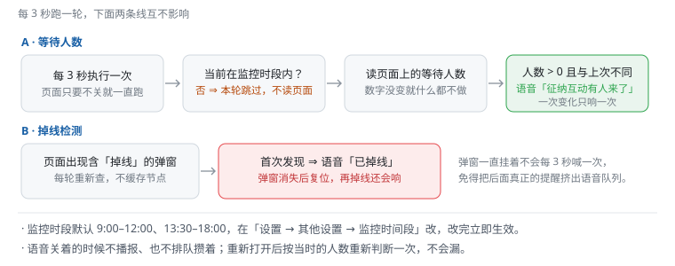

# 监控与语音播报 · 使用手册

> 面向坐席的日常使用说明：怎么开、什么时候响、为什么没响。
> 技术实现（定时器、选择器、语音队列）见 [monitor.md](monitor.md)。

## 1. 它替你盯什么

两件事，都是**只在变化时说一次**，不会反复吵你：

| 情况 | 播报的话 | 什么时候说 |
|---|---|---|
| 有人进入等待队列 | 「征纳互动有人来了」 | 等待人数从无到有、或数字变大时 |
| 会话掉线 | 「征纳互动已掉线」 | 页面弹出含「掉线」的提示框时（弹窗一直挂着也只说一次） |

## 2. 开关在哪

站点标题栏最左边：**扬声器图标 + 小开关**（见图）。点一下开、再点一下关，所有窗口共用这一个开关，不用挨个设置。

## 3. 只在工作时间盯

默认只在 **上午 9:00–12:00、下午 13:30–18:00** 检测，午休和下班后完全不响。时段不对就改：

> **设置 → 其他设置 → 监控时间段**，点时间直接选，改完立即生效，不用重启脚本。

工作时段外页面照常能用，只是脚本不读人数、不播报。

## 4. 为什么有时候没响

| 现象 | 原因 |
|---|---|
| 明明有人来了却没声音 | ① 语音开关没开；② 当前不在监控时段；③ 浏览器还没「醒」——刚打开页面没点过任何地方时，浏览器禁止自动发声，**点一下页面任意位置**再等下一次变化。 |
| 掉线了没报 | 掉线弹窗出现前就已经播过一次（弹窗没关不会再报）；确认弹窗是不是早就挂着。 |
| 声音是机器音 | 用的是浏览器自带的中文语音，音色跟系统/浏览器有关，脚本不做语音合成。 |
| 人数一直没动静 | 非工作时段本来就不检测；工作时段内仍无反应，看 [运行日志](log-guide.md) 里有没有「找不到人数元素」。 |

## 5. 相关功能

- 播报的每一条都会记进**运行日志**（四色分级），排障先看它：[log-guide.md](log-guide.md)。
- 有人进来之后要回话，配合 **常用语**（右侧栏话术一键填入）或 **飞书快捷短语**（按对话内容自动弹回复）用，见 [phrases-guide.md](phrases-guide.md) / [quick-reply-guide.md](quick-reply-guide.md)。

## 6. 技术说明

[monitor.md](monitor.md) —— 给 AI / 开发者看：模块地图、检测选择器、语音队列参数、已知坑。
