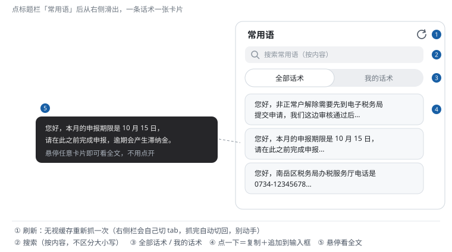

# 常用语 · 使用手册

> 面向坐席：怎么打开、怎么搜、怎么一条填进聊天框。
> 技术实现（抓取原理、缓存键、TinyMCE 写入）见 [phrases.md](phrases.md)。

## 1. 它是干什么的

把页面右侧栏「**常用话术**」搬进一个独立弹窗：双 tab + 搜索，点一条就**复制到剪贴板并追加到输入框末尾**——不用再在右侧栏里翻树找话术。

话术内容就来自你在页面右侧栏维护的那份，脚本只是换个方式打开它，**没有第二份数据**。

## 2. 怎么用

1. 点标题栏「**常用语**」图标（第一次打开会自动抓取，见下）；
2. 用顶部搜索框按内容过滤（不区分大小写），或切「全部话术 / 我的话术」两个 tab；
3. 鼠标悬停卡片可以看**全文**（列表里只显示前几行）；
4. 点一下：复制 + 提示音 + 内容**追加到输入框末尾**，检查后发送。

> ⚠️ **是追加，不是替换**：输入框里已经写了的字不会被清掉，话术接在后面。
> 想整段替换输入框内容，请用 **飞书快捷短语**（见 [quick-reply-guide.md](quick-reply-guide.md)）——两套机制对比见第 5 节。

## 3. 第一次打开会「自己动一下」

右侧栏的话术是点开文件夹才加载的。脚本第一次抓取时会**程序化地**替你展开话术树：右侧栏会自动切到「常用话术」tab、逐个展开文件夹，读完自动切回「会话人信息」。

**抓取期间别去点右侧栏**，几秒钟就完。抓完列表就出来了，之后打开都是**秒开**（走本地缓存，零请求）。

## 4. 更新与常见问题

| 想做的事 | 怎么做 |
|---|---|
| 你在右侧栏改了话术，想立刻同步 | 点弹窗标题旁的**刷新图标**（见图 ①），无视缓存重新抓 |
| 不点刷新会自己更新吗 | 不会。缓存是**长期**的，只有点了刷新或本地没有缓存时才重新抓 |
| 提示「没有读到任何条目」 | 先确认页面**已进入会话**（右侧栏存在）；还不行多为站点改版，见 [troubleshooting.md](troubleshooting.md) |
| 点了卡片输入框没内容 | 确认已进入具体会话（输入框还没初始化时填不了）；仍不行看 [troubleshooting.md](troubleshooting.md) |
| 搜不到某条话术 | 搜索匹配的是**话术内容**；确认它在右侧栏的「常用话术」里真实存在（脚本不添加、不修改话术） |

## 5. 和「飞书快捷短语」别搞混

界面上两个名字很像的东西，是两套完全不同的机制：

| | **常用语**（本篇） | **飞书快捷短语** |
|---|---|---|
| 话术从哪来 | 页面右侧栏「常用话术」 | 你自己的飞书多维表格 |
| 怎么出现 | 打开弹窗自己挑 | 按对话内容**自动**在输入区上方浮出按钮 |
| 填入方式 | **追加**到输入框末尾 | **整体替换**输入框 |
| 使用手册 | 本篇 | [quick-reply-guide.md](quick-reply-guide.md) |

## 6. 技术说明

[phrases.md](phrases.md) —— 给 AI / 开发者看：抓取触发链、DOM 选择器、缓存与刷新、TinyMCE 写入函数。
