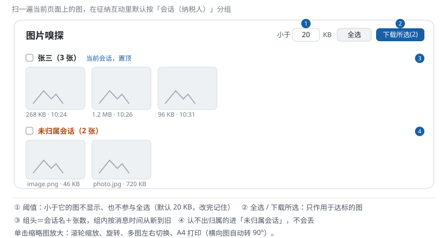

# 图片嗅探 · 使用手册

> 面向坐席：怎么扫出页面上的图、按会话下载或打印。
> 技术实现（候选收集、体积测量、会话归组算法）见 [sniffer.md](sniffer.md)。

## 1. 它是干什么的

把**当前页面上出现过的图片**一次扫出来，列成网格：放大预览、单张下载、勾选批量下载、按 A4 打印。在征纳互动工作台上，还会自动**按会话（纳税人）分组**——你发过的、收过的图都在各自的组里，不用再翻聊天记录找图。

## 2. 怎么用

1. 点标题栏「**图片嗅探**」图标；
2. 弹窗里直接就是扫好的图：
   - **单击缩略图**放大——滚轮缩放、旋转、多图左右切换；
   - 放大后工具栏的「**打印**」= 按当前原图 A4 纵向打印（横向图自动转 90°；打印对话框里缩放选 100%）；
   - 勾选若干张 → 右上角「**下载所选(N)**」批量下载，进度实时显示，失败的会标出来；
   - 组头上有**全选本组**的勾选框，「当前会话」的组永远置顶。

## 3. 阈值是干嘛的

顶部「**小于 [20] KB**」是过滤条件：体积小于它的图（基本是图标、表情）不显示、也不参与全选。

- 觉得图太少 → 调小（比如 5）；图标太多 → 调大；
- 改完点别处即生效，**数值会记住**；
- 体积拿不到的大图不会被误过滤——它们会折叠显示在组尾，照常可预览下载。

## 4. 会话分组规则

- **「当前会话」置顶**，其余按会话名列组；组头显示「会话名（N 张）」；
- 组内按**消息时间从新到旧**排；取不到时间的图排最后、文件名标红；
- 认不出归属的图进「**未归属会话**」，不会丢；
- 在普通网页（非工作台）打开时没有会话概念，自动退回一个平铺列表；
- 分组关系记在**本机**：今天扫过的图，过几天再扫，即使聊天记录已翻篇，图还能归回原会话。

## 5. 已知限制

| 情况 | 说明 |
|---|---|
| 别的会话的图没扫到 | 工作台一次只给当前会话的消息——点开那个会话再扫一次；或者图还留在页面上时再扫 |
| 缩略图裂了 / 下载 403 | 图片直链带签名会**过期**，重新扫描即恢复 |
| 视频扫不出来 | 视频在扫描阶段就被排除；动图（gif）按图片保留 |
| 想关掉后台预测量 | 「设置 → 其他设置 → 图片嗅探：先在后台预测量图片大小」——关掉后只在开窗时测量（开窗会稍慢） |

## 6. 常见问题

| 现象 | 怎么办 |
|---|---|
| 全部候选都被过滤掉（提示可调低阈值） | 顶部把阈值调小再扫 |
| 打印出来字太小 / 图太小 | 打印对话框里缩放必须选 **100%**；横向图脚本已自动转 90° |
| 批量下载个别失败 | 会自动重试；仍失败的单独再点一次下载。跨域大图走后台取流，网络抖动会偶发失败 |
| 图里混着站点自己的图标 | 调大阈值，或确认是旧版本（站点头像、表情已按内置规则排除） |

## 7. 技术说明

[sniffer.md](sniffer.md) —— 给 AI / 开发者看：收集来源（DOM/懒加载/CSS 背景图）、零请求测体积链路、Vuex 会话归组、批量下载流水线与冒烟断言清单。
