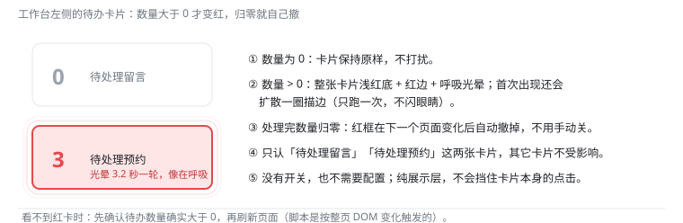

# 待办提醒 · 使用手册

> 面向坐席：什么时候会变红、怎么让它消下去。
> 技术实现（DOM 识别、呼吸动画、扫描策略）见 [todo.md](todo.md)。

## 1. 它是干什么的

工作台左侧有「**待处理留言**」「**待处理预约**」两张待办卡片。只要某张卡片上的数量**大于 0**，脚本就把整张卡片点亮成红色呼吸提醒——余光扫到就知道有活没干完；数量归零红框**自动撤掉**，不用你管。

## 2. 你需要做的

**什么都不用做**——没有开关、没有配置、不用点任何东西：

- 数量 > 0：卡片浅红底 + 红边，外圈光晕约 3.2 秒一轮（接近呼吸节奏，醒目但不刺眼）；刚出现时还会扩散一圈描边，之后就是安静地呼吸；
- 数量归 0：下一个页面变化后红框自动消失，卡片恢复原样；
- 纯展示层，**不挡点击**：卡片该点还是能点。

## 3. 常见问题

| 现象 | 说明 |
|---|---|
| 数量明明是 0，卡片还是红的 | 等 1~2 秒——红框在页面**下一次变化**后才撤；仍不消失就刷新页面。 |
| 数量大于 0，卡片不红 | 刷新页面。极少数情况下脚本模块没跑到这一步（刷新即恢复），排查过程可看[运行日志](log-guide.md)。 |
| 红色太亮 / 呼吸太快 | 这是与使用者逐轮调校后的定版参数（底色 `#ffe6e6`、周期 3.2s），实机 175% 缩放下刻意保证「一眼能分出来」，不建议再调淡。 |
| 想提醒别的卡片（比如「待处理工单」） | 目前只认「待处理留言 / 待处理预约」两张；扩展关键词属于功能变更，提需求即可。 |
| 标题栏会多出角标吗 | 不会。提醒只存在于卡片本身，没有全局角标、没有语音、没有弹窗。 |
