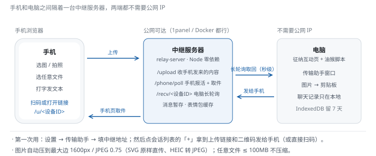
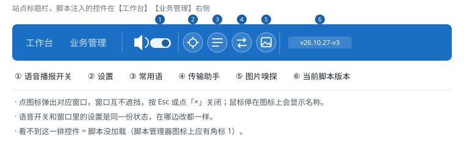

# 传输助手 · 使用手册

> 面向坐席：手机上的图怎么进电脑剪贴板、电脑怎么把文件丢给手机。
> 技术实现（长轮询协议、会话持久化、中继接口）见 [transfer.md](transfer.md)。

## 1. 它是干什么的

手机 ↔ 电脑互传图片 / 文件 / 文本，中间经过你自己的一台中继服务器：

最常见的用法：纳税人用手机发来身份证照片 → 手机浏览器上传 → 电脑自动收到 → 点一下复制 → 在征纳互动聊天框 **Ctrl+V** 直接粘贴发送。反过来电脑也能把文本、图片、文件发给手机。

## 2. 第一次使用（5 分钟）

> 已有中继服务器的（比如之前配过）跳过第 1 步。

1. **确认中继服务器在线**：由部署同学维护；浏览器打开 `https://<中继地址>/health`，看到 `{"ok":true,...}` 就是活的；
2. **电脑填地址**：标题栏「设置 → 传输助手」→ 中继服务器地址填 `https://<中继地址>`（末尾**不带** `/`），点别处或回车生效；
3. **配对**：传输助手窗口第二栏点「**+**」，弹出本机专属的上传链接（`https://<中继>/u/<设备ID>`）和**二维码**——二维码是本机生成的，不经过第三方；
4. **手机接入**：手机扫码或打开链接 → 进入聊天窗 → 选图 / 拍照 / 选文件 / 打字发送；
5. **电脑收货**：内容自动进入传输助手；点图片上的「**复制**」→ 到聊天框 Ctrl+V。

发一条「测试图片」验证链路通不通（配对窗口里有现成按钮）。

## 3. 日常使用

| 想做什么 | 怎么做 |
|---|---|
| 手机 → 电脑 | 手机聊天窗发图 / 文件 / 文本，电脑端自动收到 |
| 电脑 → 手机 | 传输助手聊天区底部输入：表情 / 图片 / 任意文件 / 文本，Enter 发送 |
| 把收到的图发进聊天框 | 图片上点「复制」→ 聊天框 Ctrl+V（不用先存文件） |
| 收到时自动弹窗 | 设置 → 传输助手 → 打开「收到内容时自动打开传输助手」；关着就只累计未读角标 |
| 找之前传过的东西 | 第一栏「文件」按会话翻历史文件；聊天记录**只存本机**，保留最近 7 天 |
| 多台手机 | 每台手机扫同一个码即可，各自一条会话，互不混 |
| 换表情 | 聊天输入区自带在线表情包（8 个合集），发出去的也是图 |

## 4. 手机上传页的细节

- 图片自动压缩（最大边 1600px、JPEG 0.75），流量省、速度快；SVG 原样直传；HEIC（iPhone 默认格式）自动转 JPEG；
- 任意文件 ≤ **100MB**，文件不做压缩；
- 上传有进度条，失败会标原因，重发即可；
- 刷新页面不丢聊天记录（记录在本机，图片刷新后照常能预览）。

## 5. 排障速查

| 现象 | 怎么办 |
|---|---|
| 电脑收不到 / 手机打不开页面 | ① 「设置 → 传输助手 → 企业信息」里核对中继地址、设备 ID 与在线手机（排障先看这里）；② `curl http://<中继>/health` 确认服务器活着；③ 中继**更新后必须重启**才生效 |
| 内容落进「手机」聚合会话 | 中继或手机页版本过旧，升级后重启中继、刷新手机页 |
| 同一条消息弹了好几个窗 | 同一台电脑开着多个跑了脚本的标签页——中继是广播投递，关掉多余的标签页 |
| 想清空所有传输记录 | 设置 → 传输助手 → 「清空全部传输记录」（只清本机，不动手机上的文件） |
| 手机上发的图电脑端裂图 | 直链签名过期，让手机重发或重新上传 |

更多环境类问题见 [troubleshooting.md](troubleshooting.md)。

## 6. 技术说明

[transfer.md](transfer.md) —— 给 AI / 开发者看：设备 ID 与按用户隔离、长轮询协议、两端持久化（IndexedDB）、中继接口清单与部署。
